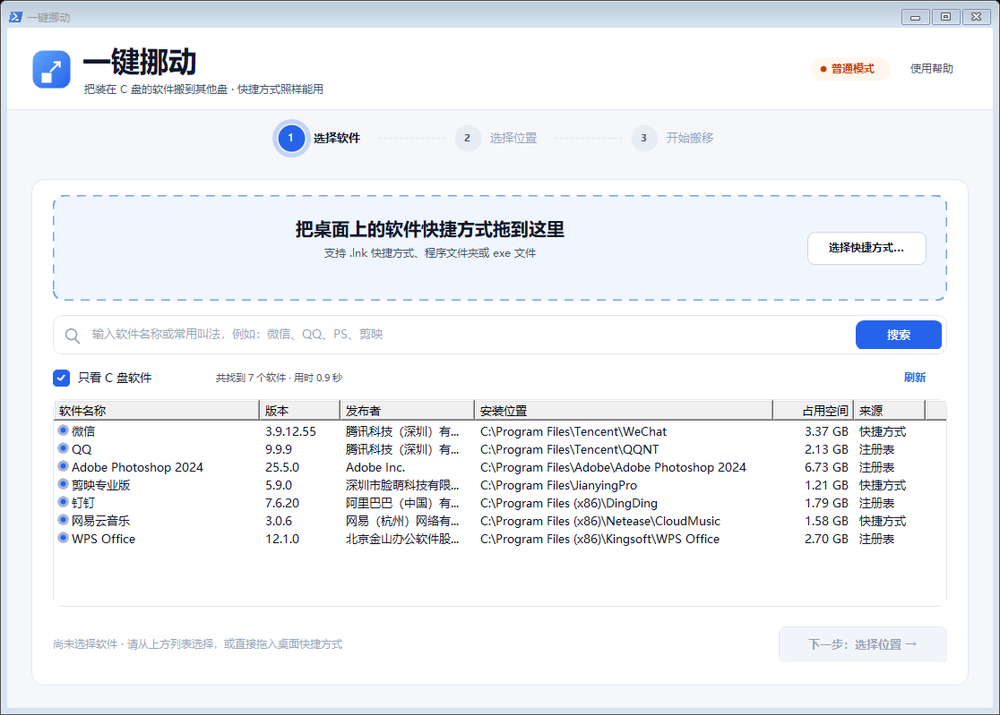
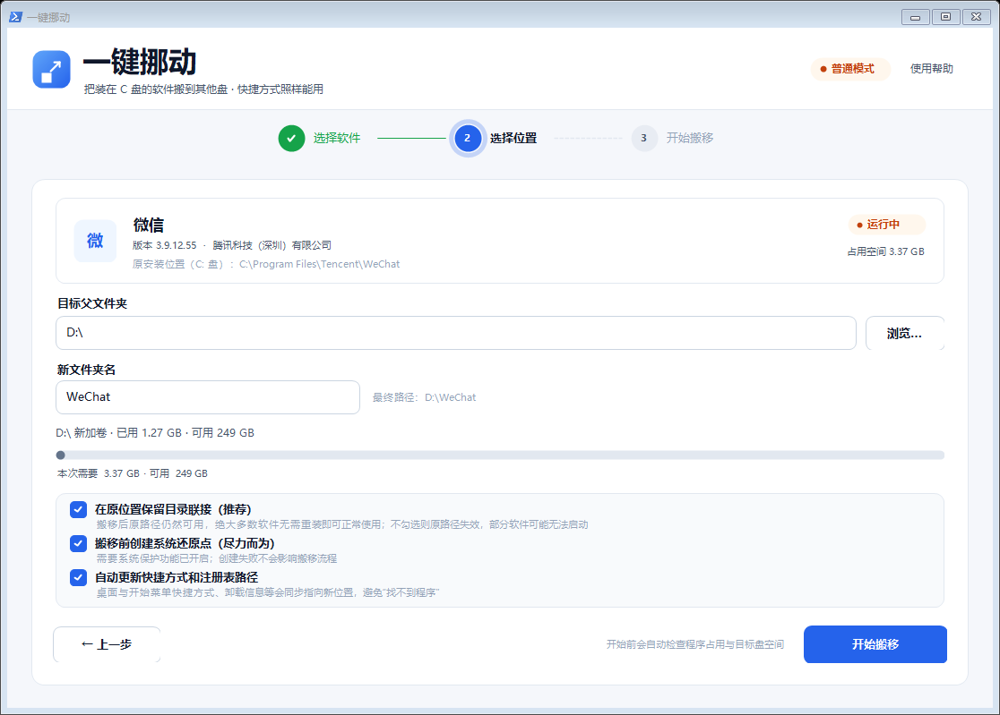
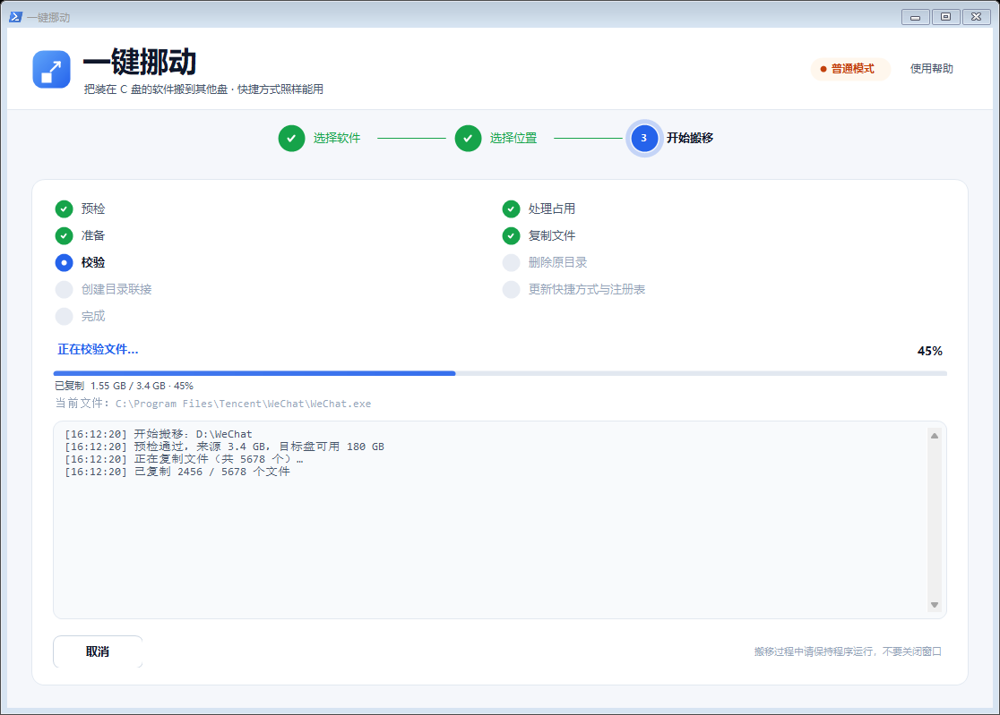
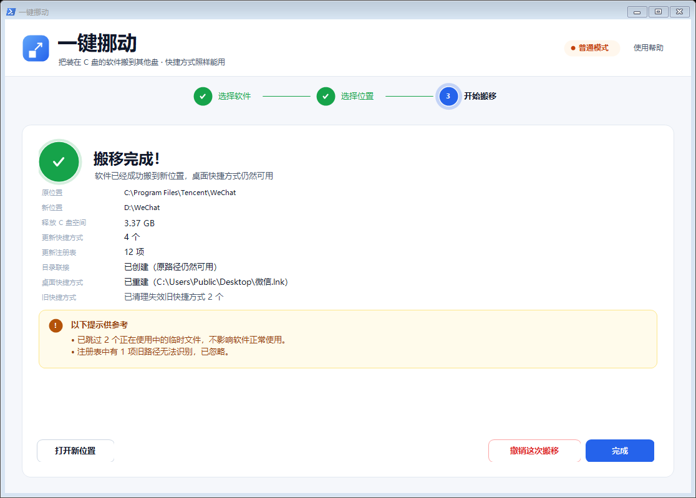

# 一键挪动（One Key Move）

> 把装在 C 盘、又不敢乱动的软件，一次搬到别的盘。搬完桌面快捷方式照常能用。

**一键挪动** 是一个 Windows 10 / 11 上的绿色小工具（单文件 exe，约 320 KB）。它把误装到 C 盘的软件整体迁移到 D/E 盘，同时自动处理快捷方式、注册表路径、被占用的进程，并在原位置留下一个「目录联接」——所以即使某些软件不认路径变化，也能继续正常运行。

*English: One Key Move is a small Windows utility (single .exe, no installer) that relocates programs installed on the C: drive to another disk, updates shortcuts and registry paths, handles locked files, and leaves a junction behind so existing paths keep working. Undo is one click.*

---

## 界面预览

| 第 1 步 · 选择软件 | 第 2 步 · 选择位置 |
| --- | --- |
|  |  |

| 第 3 步 · 搬移进度 | 搬移成功 |
| --- | --- |
|  |  |


更多截图在 [`docs/screenshots`](docs/screenshots)。

---

## 它解决什么问题

- 软件默认装到 C 盘，C 盘越用越满，但不敢直接剪切 —— 快捷方式失效、注册表对不上、软件直接打不开。
- 用「文件夹属性 → 移动到」：很多软件不认，卸载/更新会出错。
- 用第三方搬家工具：动辄几百 MB 安装包、要付费、还夹带东西。

一键挪动只做一件事，但把这件事的配套工作都做完了：

1. **复制** 到新位置 → **校验** 文件数与字节数 → 原目录改名备份 → **原路径建目录联接** → 删除备份。
2. 更新桌面 / 开始菜单快捷方式与注册表中的安装路径。
3. 重建桌面快捷方式，清理指向旧位置的失效快捷方式。
4. 任何一步失败自动**回滚**，源目录保持原样；成功后可以一键**撤销**。
5. 全程写**搬移日记**与失败诊断日志，出问题能查、能反馈。

---

## 主要功能

- **拖快捷方式就能定位**：把桌面 `.lnk` 拖进窗口，自动解析目标程序与安装目录；也支持拖文件夹、exe。
- **按名字搜索**：输入软件名、常见叫法或缩写（例如 `wx`→微信、`ps`→Photoshop），自动搜索已安装程序并排序。
- **程序列表**：从注册表、开始菜单、App Paths、进程等多来源建立索引，默认只看装在 C 盘的程序，并显示占用空间。
- **目标位置选择器**：列出驱动器与目录树，可直接**新建文件夹**、**重命名**，新建后列表与树即时刷新；选中空文件夹即表示「就搬到这里」。
- **被占用也能搬**：检测占用进程与服务，可结束进程后继续；系统关键进程会被保护；无法立即结束的服务可安排「重启后自动完成」。
- **安全兜底**：预检目标磁盘空间、禁止把程序搬进自己目录内部、系统关键目录拒绝搬移、失败自动回滚、可撤销。
- **中文界面**：三步向导，自绘控件，支持高 DPI，窗口可缩放。
- **日志**：`%ProgramData%\YijianNuodong\logs\` 下按天记录运行日志；失败时额外生成一份诊断文件，附上环境、阶段、错误、占用信息与最近日志。

---

## 系统要求

- Windows 10（1809+）或 Windows 11，64 位。
- .NET Framework 4.8（Win10 1903+ / Win11 自带，无需安装）。
- 需要管理员权限（程序清单里声明了 `requireAdministrator`，启动时系统会弹 UAC）。
- 建议目标磁盘至少有「软件体积 × 1.2 + 1 GB」的可用空间。

> **关于 SmartScreen / 杀毒软件提示**：exe 没有代码签名证书，Windows SmartScreen 会提示「已保护你的电脑」。点「更多信息 → 仍要运行」即可；也可以运行同目录的 `首次运行.cmd`（自动解除文件锁定并可选加入 Defender 排除项），或者按下面的步骤自行从源码编译。介意的话，请在虚拟机或先备份后使用。

---

## 快速开始

1. 下载 Release 中的 `one-key-move_vX.Y.Z.zip` 并解压到固定目录（升级时覆盖同一目录）。
2. 双击 `一键挪动.exe`（或先运行 `首次运行.cmd` 处理 SmartScreen/白名单）。
3. 第 1 步：拖入桌面快捷方式，或直接搜索软件名。
4. 第 2 步：选择目标文件夹（可新建/改名），确认「最终路径」后点「开始搬移」。
5. 第 3 步：等待完成；成功后桌面快捷方式会被重建，原位置保留目录联接，可点「打开新位置」或「撤销这次搬移」。

详细说明见打包内的 `使用说明.md`（`docs/` 下另有架构与测试说明）。

---

## 工作原理（为什么搬完还能用）

```
C:\Program Files\Foo\          ← 只剩一个目录联接（Junction）
        └── 指向 ──────────→  D:\Software\Foo\   ← 真正的程序文件
```

- **目录联接（Junction）** 是 NTFS 的目录重定向，对绝大多数程序完全透明：原路径仍然可读写，软件以为自己还在 C 盘。
- 快捷方式 / 注册表 `InstallLocation`、`UninstallString`、服务的 `ImagePath` 等同步指向新位置。
- 需要重启才能完成的搬移，会注册一次性启动任务，开机后自动收尾。
- 每次都写搬移日记（`%ProgramData%\YijianNuodong\journal\`），撤销时按日记逐条还原。

更多实现细节见 [`docs/ARCHITECTURE.md`](docs/ARCHITECTURE.md)。

---

## 从源码构建

不需要 Visual Studio，只要 Windows 自带的 .NET Framework 4.8 编译器：

```powershell
# 在仓库根目录执行
powershell -ExecutionPolicy Bypass -File .\build.ps1 -Target exe
# 产物：dist\一键挪动.exe
```

- 构建脚本调用 `C:\Windows\Microsoft.NET\Framework64\v4.0.30319\csc.exe`（C# 5 语法），校验清单、图标、版本信息：`tools\verify-build.ps1`。
- 运行逻辑自检：`powershell -ExecutionPolicy Bypass -STA -File tests\run-tests.ps1`。
- 运行端到端搬家回归（在临时目录造假程序，真实跨盘搬家 → 校验 → 撤销）：`powershell -ExecutionPolicy Bypass -STA -File tests\e2e-move.ps1`。需要第二个固定磁盘；没有时会退化为同盘并打 SKIP。
- 生成发布包：`tools\package.ps1`（输出 `out\一键挪动\` 与 zip）。
- 界面预览渲染（无需显示器）：`tools\render-ui.ps1`，产物写到 `docs/screenshots\`。

> 本仓库的 `build.ps1` 用 UTF-8 源文件与中文资源；请保持 `.ps1` 文件的 UTF-8 BOM，否则 PowerShell 5.1 会解析乱码。

---

## 目录结构

```
src\
  Contracts\     数据模型、路径/文件工具、日志、设置（公共契约）
  Core\          搬家引擎：程序定位、占用检测、目录联接、注册表/快捷方式改写、日记、重启后完成
  UI\            WinForms 三步向导、文件夹选择器、自绘控件
  SelfTest\      反射调用的逻辑自检
tools\           图标生成、构建校验、打包、界面渲染、GUI 冒烟
tests\           逻辑自检入口、端到端搬家回归
resources\       图标、首次运行辅助脚本
docs\            架构说明、界面截图
```

---

## 常见问题

**Q：搬完原路径还在，会不会占两份空间？**
不会。原路径只是一个几百字节的目录联接，文件只在新位置有一份。

**Q：软件更新/卸载会不会出问题？**
大多数软件正常。少数带数字签名校验或自更新的软件，建议搬完后在原位置直接运行一次确认；若异常可用「撤销这次搬移」还原，或卸载后重装到新盘。

**Q：提示「程序正在运行，无法搬移」？**
在占用面板里结束对应进程后继续；服务类程序可安排「重启后自动完成」。系统关键进程不会出现在可结束列表里。

**Q：C 盘空间没释放？**
确认目标盘与源盘不是同一块物理盘；搬移本身会先校验再删除旧文件，空间在最后一步释放。可在「打开新位置」里确认文件已就位。

**Q：为什么每次升级版本 Windows 又提示一次？**
未签名程序的 SmartScreen 按文件哈希判定；升级后哈希变了，所以会再次提示。把解压目录固定下来并加入排除项可减少重复提示，根治需要代码签名证书。

**Q：失败日志在哪？**
`%ProgramData%\YijianNuodong\logs\`（按天日志），失败时同目录 `failures\` 下还有一份诊断文件；也可以在失败页直接点「查看失败诊断日志」。

---

## 版本

当前版本 **1.0.3**。变更记录见 [`CHANGELOG.md`](CHANGELOG.md)。

## 许可证

[MIT](LICENSE) © 2026 lengsky

## 免责声明

本工具会移动真实文件并修改快捷方式/注册表。请在使用前备份重要数据，首次使用建议先挑一个不重要的软件试搬并验证「撤销」流程。作者不对因使用本工具造成的数据丢失或系统异常承担责任。使用即表示你理解并接受这一点。
