# 一键挪动 (OneKeyMove) v1.4.0

> 把装在 C 盘的软件安全搬到 D 盘 / E 盘，**搬完还能照常用**——桌面快捷方式、开始菜单、卸载、注册表路径都会自动处理。用不上的软件也能在同一个窗口里**直接卸载**。

Windows 10 / Windows 11 适用 · 单文件绿色版 · 无需安装 .NET SDK · 开源可自行编译

---

## 一、这个软件解决什么问题

大多数软件安装时默认装到 C 盘（`C:\Program Files\...`）。C 盘常常只有 100~200 GB，装几个大型软件（微信、QQ、Office、Adobe、游戏、开发工具）就满了，系统变卡、更新失败。

传统做法有两种，都很麻烦：

| 做法 | 缺点 |
| --- | --- |
| 卸载重装到 D 盘 | 要重新登录、重新配置，耗时且可能丢数据 |
| 手动剪切文件夹 | 软件直接无法启动（注册表、快捷方式、服务路径全部失效） |

**一键挪动** 采用「**复制 + 目录联接（Junction）**」方案：
把程序文件整体搬到新磁盘，再在**原位置留下一个"传送门"**（目录联接，NTFS 特性）。系统和其他程序访问原路径时，会被自动重定向到新位置。因此：

- 软件**无需重装**，双击桌面快捷方式即可使用；
- 注册表、服务、计划任务里的旧路径仍然有效；
- 应用商店外的绝大多数软件（微信、QQ、WPS、Office、浏览器、开发工具…）都可以这样搬。

---

## 二、核心特性

- **拖一下就能定位**：把桌面上的软件快捷方式（`.lnk`）拖进窗口，自动读取快捷方式属性，找到软件真实安装目录；也支持直接拖入程序文件夹或 `.exe`。
- **按"俗称"搜索**：记不住软件英文名没关系，输入「微信」「QQ」「PS」「剪映」「钉钉」「网易云」等通用叫法即可，内置 60+ 常见软件别名库（中文名 / 英文名 / 拼音 / 简称互查）。
- **自动列举已安装软件**：从注册表卸载项、开始菜单、App Paths、运行进程、常见安装目录多路汇总，默认只显示占用 C 盘的软件并标注大小，一眼看出谁最占空间。
- **目标位置自由指定**：内置文件夹选择器，支持**新建文件夹**、**重命名文件夹**、切换磁盘、直接输入路径，并实时显示目标盘剩余空间与"最终路径"预览。
- **被占用也能搬**：
  1. 用 Windows Restart Manager 精确定位"正在占用文件的进程"和"关联服务"；
  2. 一键**优雅关闭**窗口进程，必要时**强制结束**（自动保护系统关键进程）；
  3. 自动停止/迁移/重启相关服务；
  4. 实在搬不动？可登记「**重启后自动完成**」，开机的系统级计划任务会在所有软件启动前完成搬移。
- **搬完自动修引用**：批量更新桌面/开始菜单快捷方式、注册表卸载信息、App Paths、服务 ImagePath。
- **桌面快捷方式有保障**：搬完会把所有指向旧路径的快捷方式**就地改指**新位置（不会留下失效图标）；如果桌面上没有可用快捷方式，会自动补建一个指向新位置的快捷方式；搬移造成的悬空旧 `.lnk` 会被自动清理。
- **失败自动回滚**：任何一步出错（磁盘满、权限不足、文件被锁）都会自动恢复原状，不会出现"搬了一半"的烂摊子。
- **可撤销**：每次搬移都写"搬家日记"，完成后可一键**撤销**，文件连同引用一起还原。
- **失败可诊断**：每次失败都会生成一份独立的诊断日志（阶段、错误原因、占用进程、回滚结果、最近日志），方便用户反馈、也方便开发者据此持续优化。
- **顺手卸载（v1.1.0 新增）**：用不上的软件不用再搬，选中后点「卸载这个软件」即可。自动从注册表找出官方卸载命令（MSI 走 `msiexec /X`，普通程序走它自带的 uninstall.exe），先备份注册表卸载项、再结束占用进程、运行卸载程序、最后清理残留目录与快捷方式。没有官方卸载程序的绿色软件，必须勾选「我确认手工清理」才会动手。
- **看得懂这个软件是干嘛的（v1.2.0 新增）**：选中软件后，左下角除了图标和安装位置，右侧还会显示一段**社区里说人话的介绍**——"微信：国民级聊天软件，发消息、传文件、扫码支付"这种，而不是官方文档里的套话。同时给出三个结论标签：**第三方软件 / 系统自带 / 运行库 / 驱动**、**能不能搬**、**能不能卸**，并附一条提醒（比如"搬之前先退出微信，否则会提示文件被占用"）。内置 100+ 条常见软件说明，没收录的软件也会按安装位置和名字给出保底判断（装在 `C:\Windows` 下一律判为系统组件）。
- **点表头就能排序（v1.2.0 新增）**：软件列表的每个列标题都可点击排序——点「软件名称」按字母顺序，点「占用空间」按文件大小（默认大的在前），再点一次切反向。体积还没算出来的行始终排在最后，不会把一排「计算中…」顶到最上面。
- **C 盘清理（v1.3.0 新增）**：点列表上方「清理 C 盘」，先扫描白名单里的临时文件、浏览器缓存和下载的安装包，逐项显示大小、用途、修改时间和完整路径，再由你勾选。临时文件/缓存默认勾选，安装包默认不选，安装包还会二次确认；清理前可用「打开位置」确认。只读、不存在、被占用、发生变化或属于链接的文件会跳过并写明原因，不强行结束进程；文档、照片、聊天记录、Windows Installer 缓存、软件安装目录和链接目录不会扫描。

---

## 空间盘点 / 数据搬家（v1.4.0）

主窗口软件列表上方点击 **空间盘点 / 数据搬家**。窗口打开后只读扫描，可在四个页签查看：

1. **空间盘点**：磁盘总容量/可用容量，以及 Windows、AppData、文档、Program Files、NVIDIA 缓存、休眠文件、虚拟内存等项目的路径、性质与建议。目录显示逻辑字节；硬链接、父子汇总有重叠，不能相加或当作保证释放量。超时、权限不足显示“未完整”；还原点不推测大小。
2. **可搬数据**：pip/npm/pnpm 缓存和 Codex/Claude/WorkBuddy/WorkBuddy AI 的插件子目录。已经联接到其他盘的项目显示实际位置，不遍历目标，也不能重复搬。含嵌套链接或未完整测量的项目不允许搬。
3. **安装包归档**：只列下载目录中的安装包候选，默认全部不勾选。确认不需留原位后，归档到目标父目录下的 `Installers`；目标加随机前缀防重名，逐文件 SHA256 一致才移除原文件。每份归档旁有 `.restore.txt`，可按原路径手动复制恢复；不自动覆盖既有文件。
4. **pip 默认下载目录**：仅保存用户级 `pip.ini` 的 `[download] dest`，与包缓存分开。PowerShell/CMD 下次 `pip download` 生效，命令行 `-d` 可覆盖；环境变量和虚拟环境配置可能有更高优先级。原配置先以 `.orig`（原本不存在则 `.absent.orig`）备份，可在本窗口撤销；后续配置有变动时拒绝覆盖。

数据搬家操作：先退出相关软件与自动更新进程 → 选择如 `D:\SoftwareData` 或 `E:\SoftwareData` 的父目录 → 查看表中每项最终目标路径 → 自行勾选并确认退出 → 点击 **搬移勾选数据** → 在确认框核对源/目标后执行。不会合并或覆盖既有目标，不强杀进程。复制后逐文件校验，原路径保留 Junction；完成后重新扫描确认状态。

**撤销本次搬家**按相反顺序逐项恢复；关闭窗口后可从主窗口“搬家日记”恢复。目标旁还保留执行前写入的 `.onekeymove-restore.txt` 路径凭据，该文件本身不表示执行成功。Windows、AppData 整体、休眠、虚拟内存、还原点均只展示说明，不提供直接移动或删除。

## 界面预览

| 第 1 步 · 选择软件 | 第 2 步 · 选择位置 |
| --- | --- |
| 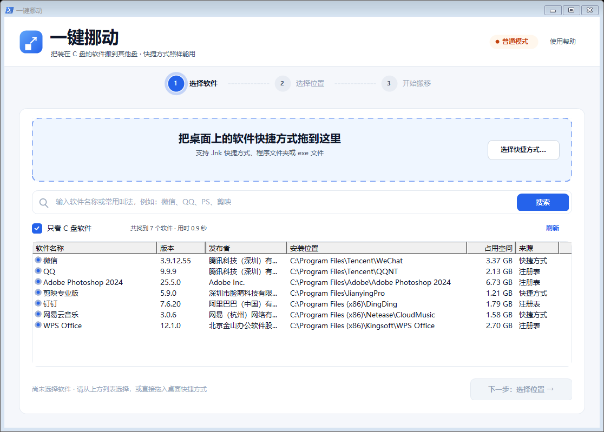 | 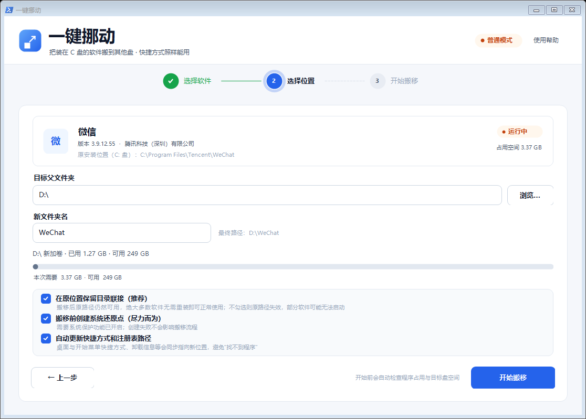 |

| 第 3 步 · 搬移进度 | 搬移成功 |
| --- | --- |
| 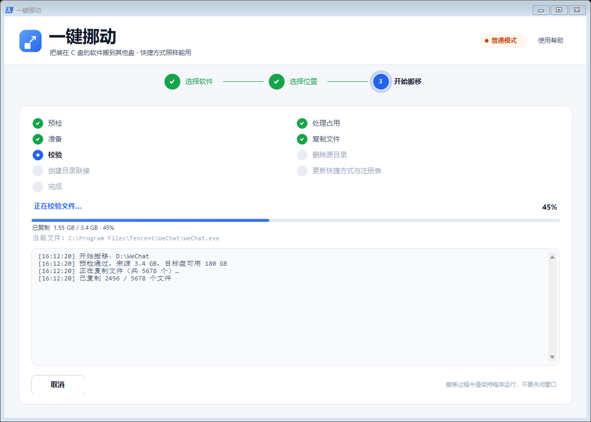 | 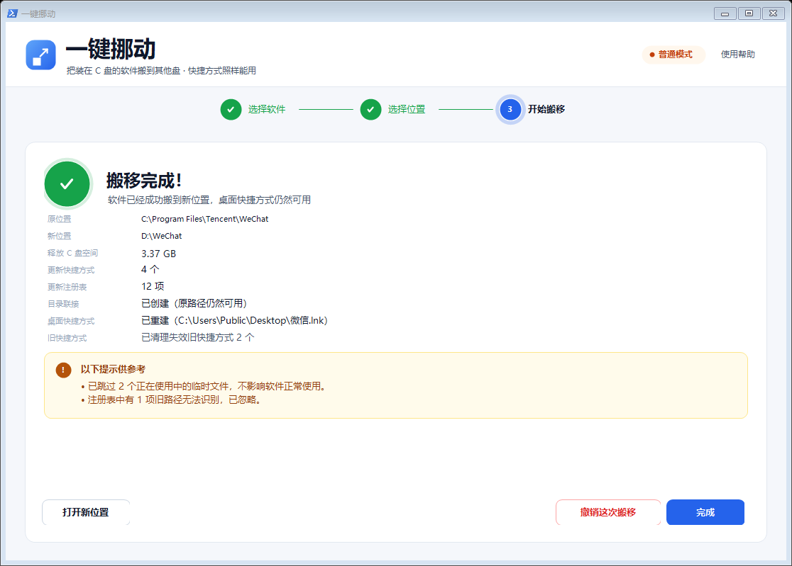 |

| 卸载 · 确认 | 卸载 · 进度 | 卸载 · 结果 |
| --- | --- | --- |
| 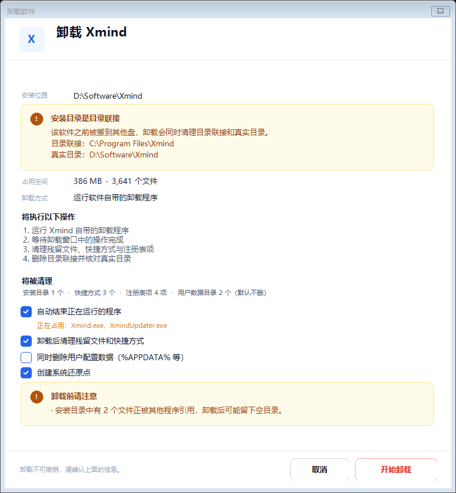 | 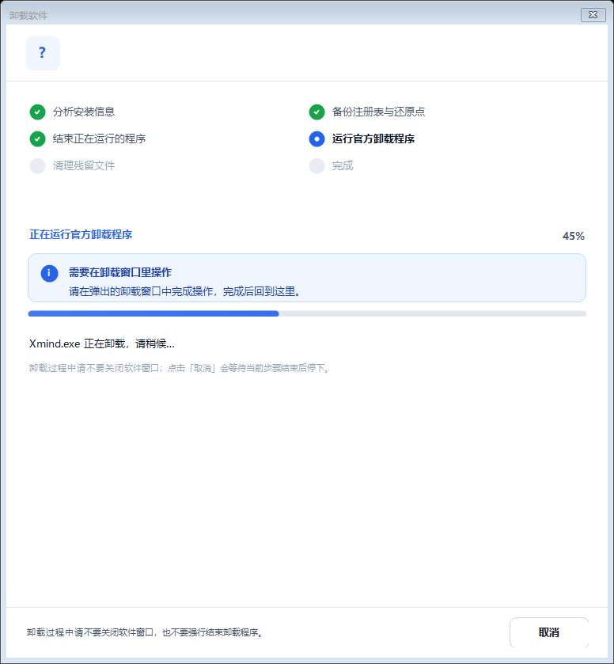 | 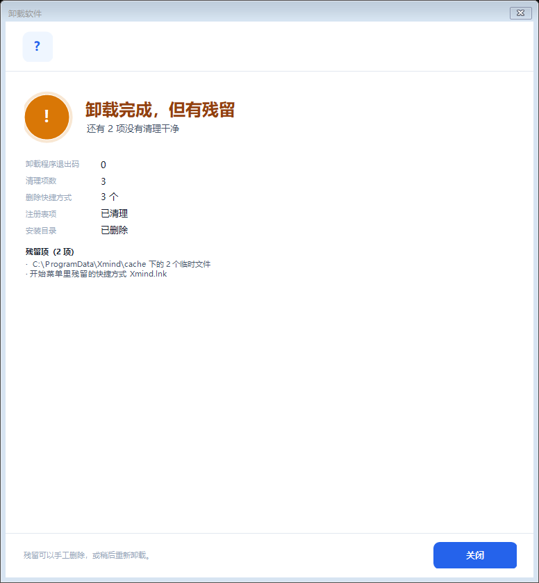 |

| 排序、软件说明与 C 盘清理 |
| --- |
| 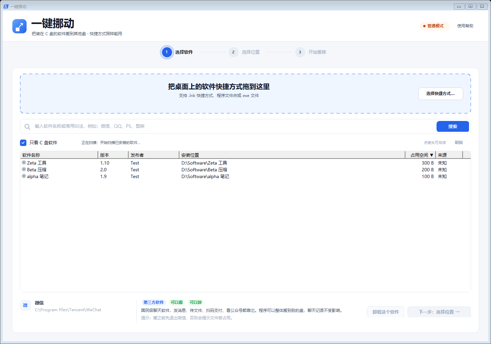 |

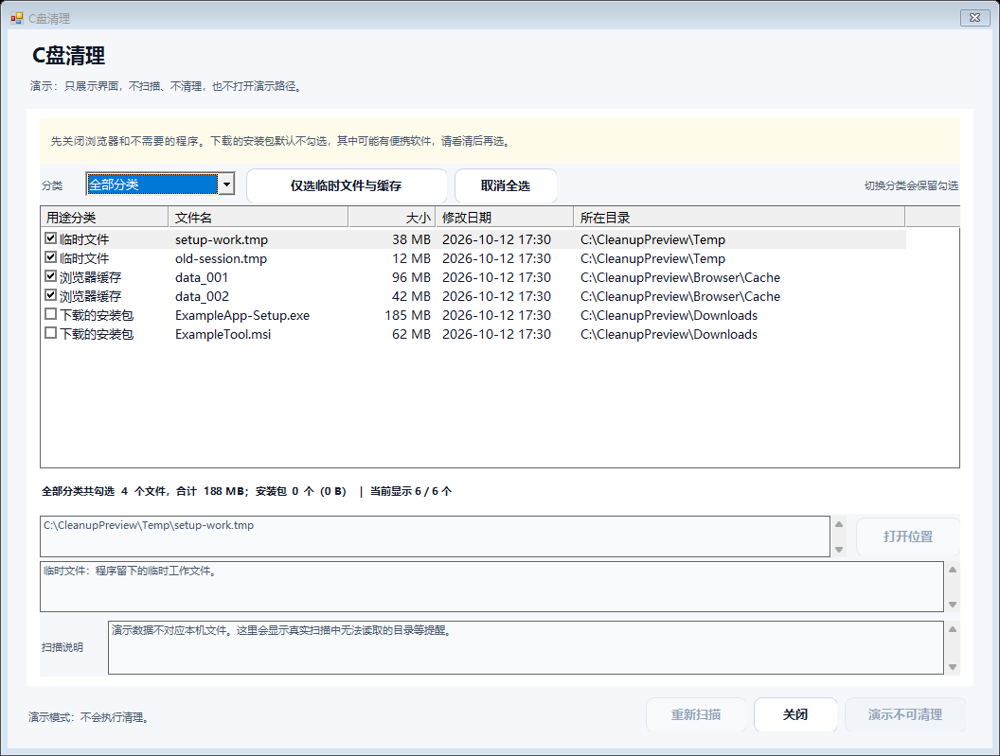

| 空间盘点（演示数据） | 可搬数据（演示数据） |
| --- | --- |
| 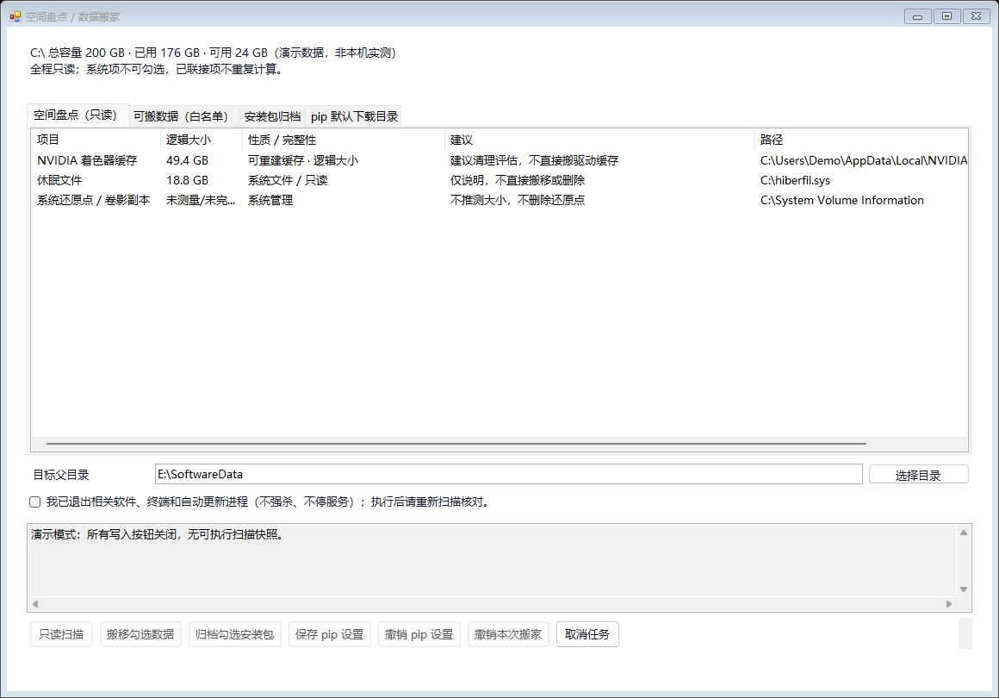 | 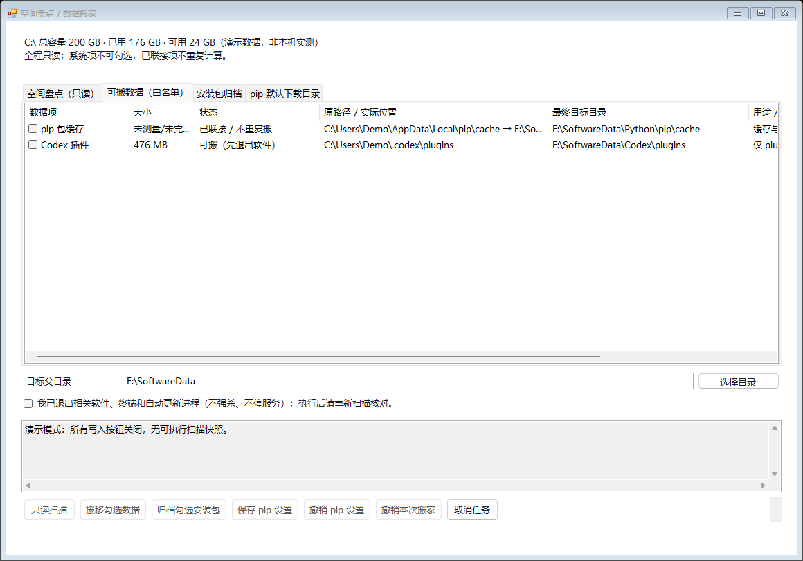 |

| 安装包归档 | pip 默认下载目录 |
| --- | --- |
| 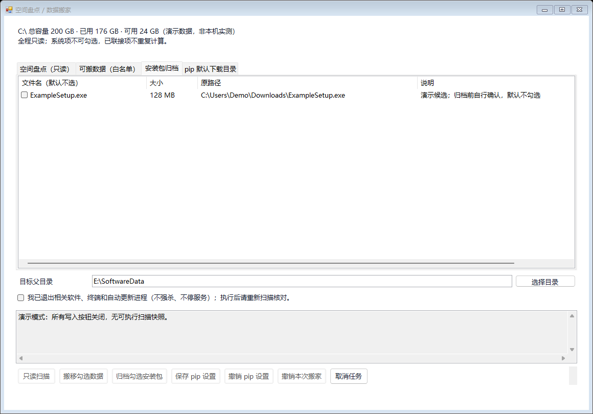 | 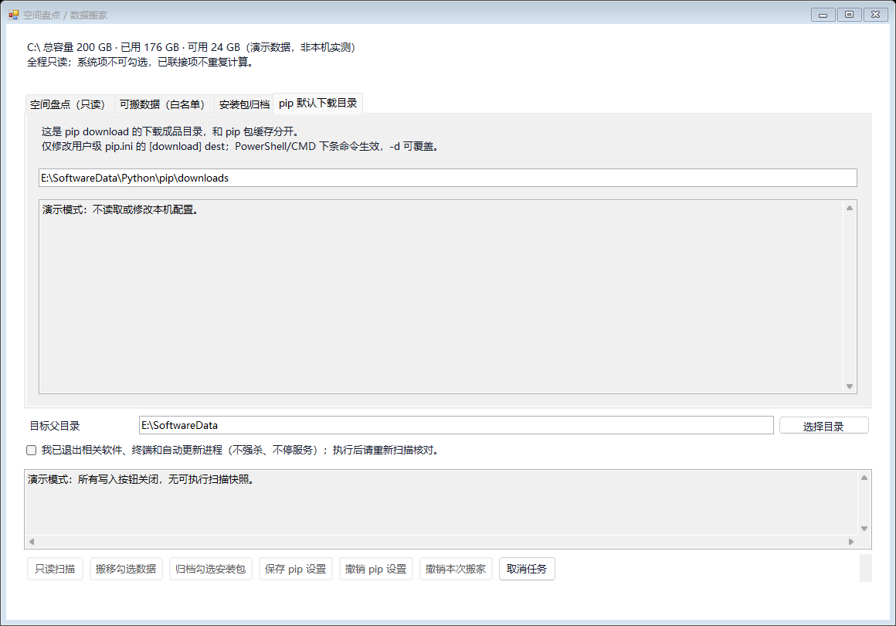 |

---

## 三、系统要求

| 项目 | 要求 |
| --- | --- |
| 操作系统 | Windows 10 / Windows 11（64 位） |
| 文件系统 | NTFS（目录联接依赖 NTFS；源盘与目标盘均为本地 NTFS 磁盘） |
| 运行库 | .NET Framework 4.8（Windows 10 1809+ 与 Windows 11 已内置，无需额外安装） |
| 权限 | **需要管理员权限**（移动 Program Files、停服务、写注册表）——程序会主动请求 |
| 磁盘 | 目标盘可用空间 ≥ 软件体积 + 200 MB 余量 |

> 提示：不支持把软件搬到网络共享 / U 盘 / FAT32 分区（目录联接只对本地 NTFS 卷有效）。

---

## 四、使用步骤

### 1. 启动
双击 `一键挪动.exe`。Windows 会弹出 UAC 授权框，点「是」（移动 Program Files 内的软件必须管理员权限）。

### 2. 选择要搬的软件（三种方式任选）
- **方式 A（推荐）**：从桌面把软件快捷方式拖进窗口蓝色虚线区域。
- **方式 B**：在搜索框输入名称或俗称，比如 `微信`、`WeChat`、`wx`、`剪映`、`PS`，回车或点「搜索」。
- **方式 C**：在列表中直接挑选（默认只列 C 盘软件，按需取消勾选可看全部）。

列表会显示：软件名称、版本、发布者、安装位置、占用空间、信息来源。选中后点「下一步：选择位置」。

### 2.5 列表排序与「这个软件是干嘛的」
- **排序**：点列表的列标题即可排序。点「软件名称」按字母顺序（再点一次反向）；点「占用空间」按文件大小，默认大的在前；版本按自然序（`1.9` 在 `1.10` 前面）。表头带 ▲/▼ 标记，体积还没算出来的行始终排在最后。
- **软件说明**：在列表里选中任意软件，左下角会显示它的图标、名称、安装位置，右侧显示三段内容——
  1. 标签：`第三方软件 / 系统自带 / 运行库 / 驱动`、`可以搬 / 搬要小心 / 别搬`、`可以卸 / 卸载小心 / 别卸`；
  2. 一段说人话的介绍（例如「Xmind：画思维导图、整理思路、做汇报大纲」）；
  3. 一条操作提醒（例如「搬之前先退出微信，否则会提示文件被占用」）。
- 说明来自程序内置的离线说明库（100+ 条常见软件），**不联网、不查官方文档**；没收录的软件会按安装位置和名字给出保底判断，装在 `C:\Windows` 下的一律判为系统组件。
### 2.6 C 盘清理（v1.3.0）
- 点列表上方的「**清理 C 盘**」进入清理窗口。窗口只读取指定白名单位置：系统临时目录、当前用户临时目录、Edge/Chrome/Brave/Firefox 缓存，以及 C 盘下载目录里的安装包文件（`.exe`、`.msi`、`.msix`、`.appx`、`.iso` 等）。
- 扫描结果逐项显示用途分类、文件名、逻辑大小、修改时间、所在目录和完整路径。临时文件与浏览器缓存按文件年龄筛选，避免刚产生的缓存被立即清掉；下载的安装包默认不勾选。
- 可以切换分类、保留或取消单项勾选；「打开位置」只会调用资源管理器定位文件，不会执行安装包。勾选安装包时会额外确认便携软件和以后重装的风险，所有清理还要再确认一次永久删除。
- 清理过程中不会强制关闭程序。被占用、只读、已变化、链接文件、多重硬链接或权限不足的项目会跳过，结果页和日志会记录完整路径、阶段、异常类型和原因；需要继续时重新扫描即可。
- 安全边界：不会扫描文档、图片、视频、聊天记录、Windows Installer 缓存、WinSxS、软件安装目录或回收站；不跟随目录链接。扫描和删除都使用同一次扫描快照，文件发生替换或路径结构变成链接时整项保留。

### 3. 选择目标位置（搬移时）

- 点「浏览…」打开文件夹选择器：
  - 顶部可切换磁盘（下拉框）或直接输入路径回车跳转；
  - 支持**新建文件夹**（按钮 → 输入名称）、**重命名**文件夹（选中后点重命名）；
  - 双击文件夹进入，选中后点「选择此文件夹」。
- 回到主界面，可修改「新文件夹名」（例如把默认的 `WeChat` 改成 `微信`），下方实时预览最终路径，如 `D:\Software\微信`。
- 勾选项（默认已勾选）：
  - **在原位置保留目录联接（推荐）**：保证搬完后软件照常运行。关闭它会让原路径失效，**不推荐**。
  - **搬移前创建系统还原点**：尽力而为，可能需要系统已开启"系统保护"。
  - **自动更新快捷方式和注册表路径**：一般保持勾选。

### 4. 开始搬移
点「开始搬移」，会先做预检（路径、空间、占用、保护目录），随后进入进度页：

`检查环境 → 处理占用 → 准备 → 复制文件 → 校验 → 删除原目录 → 创建目录联接 → 更新引用 → 完成`

- 顶部进度条显示已复制字节/百分比，下方显示当前文件、阶段日志；
- 复制阶段可点「取消」，会安全回滚；
- 若检测到程序正在运行：会给出占用清单，可选择「结束这些进程并继续」，或「重启后自动完成」；
- 完成后显示：原路径 → 新路径、释放的 C 盘空间、更新的快捷方式/注册表数量。

### 5. 完成后
- 软件照旧从桌面/开始菜单启动（实际运行在新位置）；
- 可点「打开新位置」查看文件；点「撤销这次搬移」可完整还原；
- 卸载该软件时，卸载程序仍能正常工作（注册表/路径已被修正）。

### 6. 遇到"文件一直被占用"怎么办
1. 进度页会弹出占用清单（进程名、PID、是否主窗口）以及相关服务；
2. 选「结束这些进程并继续」：程序会先尝试正常关闭窗口（发 WM_CLOSE，给软件保存数据的机会），仍不退出才强制结束（系统关键进程会被跳过并提示）；
3. 若涉及开机自启服务/驱动/杀毒软件等确实无法结束的，选「重启后自动完成」：程序会创建一个开机运行的系统级计划任务，**下次开机时在绝大多数软件启动前**完成搬移并自动创建联接。重启后你会看到搬移已完成，或到日志中查看结果。

> 建议：搬移前手动退出要搬的软件（包括托盘图标里"退出"），成功率最高。

### 7. 用不上的软件：直接卸载（v1.1.0 新增）

在软件列表里选中它，点右下角**「卸载这个软件」**（也可以右键 → 卸载这个软件），会弹出一个确认窗口：

1. **确认页**显示安装位置、占用空间、卸载方式（MSI / 官方卸载程序 / 手工清理）、将被清理的安装目录 / 快捷方式 / 注册表项 / 用户数据目录数量；
2. 勾选需要的选项（默认：自动结束占用进程、清理残留、创建还原点），点「**开始卸载**」；
3. **进度页**实时显示当前阶段：备份注册表 → 结束占用进程 → 运行官方卸载程序 → 校验 → 清理残留；中途可以「取消」；
4. **结果页**给出释放空间、删除项、残留项，失败时点「查看失败诊断日志」。

几条硬规则：

- **不可撤销**：卸载是彻底删除。程序会先创建系统还原点、并把注册表卸载项导出到 `C:\ProgramData\YijianNuodong\logs\uninstall_backup\`，出问题可据此手工回退；
- **没有官方卸载程序的绿色软件**（只能手工删目录），必须勾选「**我确认手工清理**」才会执行，避免误删；
- **系统组件会被拒绝**：Windows 目录、`Program Files` 根、盘符根、`.NET Framework` / VC++ 运行库 / 驱动等系统组件直接不允许卸载（日志里会写明原因）；
- **同目录还有别的软件时只删当前目录**，不会连带删掉邻居。

> 卸载 VS 搬移怎么选：这个软件**还要用**就搬走，**真的不要了**就卸载。卸载释放的空间通常比搬移更多，因为连注册表项和 AppData 一起清掉了。

---

## 五、安全须知（请务必阅读）

1. **不要搬这些**：Windows 目录及其子目录、`System32`、`Program Files` 根目录、`Program Files\Common Files`、`WindowsApps`（微软商店应用）、杀毒/安全软件安装目录、驱动类软件（显卡驱动、虚拟机增强驱动等）、`$Recycle.Bin`、`System Volume Information`、用户目录根。程序内置保护名单会拒绝，但请勿绕过。
2. **部分软件不支持**：有强完整性校验 / 反作弊 / 硬编码绝对路径 / 把 exe 路径写死在数字签名配置里的软件（个别游戏、部分专业软件），搬完可能无法启动。**搬之前请确保软件可以重装**，重要资料先备份。
3. **建议先建系统还原点**，或使用程序内「搬移前创建系统还原点」选项。
4. 搬移需要管理员权限，且过程中**不要强制关机**；若意外中断，多数情况下重新启动程序会提示并回滚（也可手动把新位置内容移回原路径）。
5. 搬移后原路径是一个"目录联接"，在资源管理器里显示为普通文件夹并带快捷方式箭头图标；**不要对它执行"删除"以外的操作**（删除联接本身不会删除新位置的数据，但会让软件找不到自己）。

---

## 六、常见问题 FAQ

**Q1：搬完后软件打不开怎么办？**
先点「撤销这次搬移」还原；若已关闭程序，重新打开本工具，「撤销上次搬移」入口可还原最近一次记录（日记文件位于 `C:\ProgramData\YijianNuodong\journal\`）。仍异常则重装该软件。

**Q2：为什么目标盘明明是 NTFS，创建联接还是失败？**
可能是目标路径在 U 盘/网络盘/压缩盘/挂载点上，或安全软件拦截了 `mklink`。请改用本地 NTFS 磁盘的普通文件夹，并临时关闭安全软件的"文件夹防护"再试。

**Q3：杀毒软件报毒 / SmartScreen 提示「Windows 已保护你的电脑」或「Internet 安全设置阻止打开文件」？**
本程序未做代码签名（个人工具），从网络下载/解压后 Windows 会给文件打上"来自网络"的标记（Mark-of-the-Web），因此出现这些提示属于**正常现象，不是病毒**。按下面任一方式解决即可：

1. **最快**：在「Windows 已保护你的电脑」窗口点 **「更多信息」→「仍要运行」**；若弹出「Internet 安全设置阻止打开一个或多个文件」，点 **「确定」** 继续。
2. **一次性解除锁定（推荐）**：右键 `一键挪动.exe` →「属性」→ 底部勾选/点击 **「解除锁定」** → 确定。或在 PowerShell 中执行：
   ```powershell
   Get-ChildItem -Path 'D:\你的路径\一键挪动' -Recurse -File | Unblock-File
   ```
3. **使用附带的辅助脚本**：双击 **`首次运行.cmd`**，会自动解除本目录所有文件的网络锁定，并可一键把本工具加入 Windows 安全中心排除项（需要管理员权限），随后启动程序。
4. **加入安全软件白名单**：Windows 安全中心 → 病毒和威胁防护 → 管理设置 → 排除项 → 添加排除项（文件夹或进程 `一键挪动.exe`）。第三方杀软（360、火绒等）同样在"信任区/白名单"中添加。
5. **彻底无提示**：用源码自行编译（见第七章 `build.ps1`），本地编译出的 exe 不带网络标记，通常不会触发 SmartScreen。

> 提示：若你从压缩包解压，请先把 **zip 文件本身**右键→属性→解除锁定，再解压（否则锁定会传染给里面的 exe）；或解压后对 exe 单独执行一次解除锁定。

**Q4：搬移后 C 盘空间没变化？**
- 若目标与源在同一磁盘，空间不会变化（同一磁盘内搬移无意义，程序会提示）；
- 若有文件正被占用，程序会保留原目录备份并给出提示，需重启后清理（日志会标明路径）；
- 建议用「设置 → 存储」或本工具列表确认软件实际位置。

**Q5：能搬微软商店应用（UWP）吗？**
不能。商店应用由系统管理，请用「设置 → 应用 → 移动」功能。

**Q6：搬完想在另一台电脑用同一个软件？**
搬移只改变本机路径映射，不改变授权/账号。换机仍需正常安装。

**Q7：搬完之后桌面快捷方式还能用吗？会不会出现两个图标？**
能。程序会把原快捷方式**就地改指**到新位置（双击即用），不会产生重复图标；如果原来桌面上根本没有快捷方式，会自动补建一个指向新位置的；搬移造成的悬空旧 `.lnk` 会自动清理。成功页会显示「桌面快捷方式：已重建/已更新（路径）」。

**Q8：搬移失败了，怎么反馈？**
到 `C:\ProgramData\YijianNuodong\logs\failures\` 取最新的 `fail_*.txt` 诊断日志，把它附在反馈里即可（成功页/失败页也有「查看失败诊断日志」按钮）。

**Q9：为什么每次版本更新，都要重新加白名单 / 再点一次「仍要运行」？**
这是 Windows 对**未签名程序**的正常机制，不是本程序的缺陷，原因有三层：

1. **SmartScreen 提示**：「Windows 已保护你的电脑」按文件哈希/发布者信誉判断。每次重新编译，exe 都是全新文件，信誉不会从旧版本继承，所以每个版本第一次运行都会提示一次。点「更多信息」→「仍要运行」即可。想彻底不再提示，只能给 exe 购买 **代码签名证书（OV/EV）** 后签名。
2. **安全中心「排除项」按文件夹路径生效**：如果每次把新版本解压到新文件夹（如 `一键挪动_v1.0.2` → `一键挪动_v1.0.3`），旧排除项的路径就不再匹配。**解决：固定一个目录（如 `E:\Tools\一键挪动\`），以后只把新版 exe 覆盖进去**；首次运行 `首次运行.cmd` 会自动把该目录加入排除项（v1.0.3 起默认自动添加，可用 `-NoExclude` 跳过）。
3. **第三方杀毒软件**（360/火绒等）多数按文件哈希+云端信誉判断，换版本就要重新信任一次；把固定目录加入它的信任列表可减少打扰。

**Q10：卸载和搬移该选哪个？卸载会不会把 C 盘其它东西删掉？**
还要用的软件就**搬移**（文件到别的盘，功能不变）；确定不要了才**卸载**（连注册表项、快捷方式一起清掉，释放更多）。
卸载只会处理**该软件自己的**安装目录、它自己的快捷方式、它自己的注册表卸载项。系统目录、系统组件、盘符根、本程序自身目录一律拒绝卸载；同一个父目录下还有别的软件时只删它的子目录，不会连带删邻居。

**Q11：卸载失败/中途卡住了怎么处理？**
卸载器卡住通常是官方卸载程序弹了窗口等交互（引擎默认 600 秒超时，超时不会强杀进程，会跳过残留清理）。可以：
1. 切到那个卸载器窗口手工完成它；
2. 完成后回到结果页看残留项，必要时手工删除剩余目录；
3. 到 `C:\ProgramData\YijianNuodong\logs\uninstall_backup\` 找当次备份，`如何恢复.txt` 里有还原步骤（双击 `.reg` 可恢复卸载项）。

---

## 七、从源码构建（可选）

不需要安装 Visual Studio 或 .NET SDK——Windows 10/11 自带 C# 编译器。

```powershell
# 在项目根目录执行
powershell -ExecutionPolicy Bypass -File .\build.ps1
# 产物: dist\一键挪动.exe
```

脚本会自动：定位系统内置 `csc.exe`（或 VS 的 Roslyn）→ 编译 `src\**\*.cs` → 嵌入 `app.manifest`（管理员权限清单）与 `resources\app.ico`。

开发调试用：
```powershell
# 编译成 DLL（供反射测试 / 界面渲染预览）
powershell -ExecutionPolicy Bypass -File .\build.ps1 -Target lib

# 把界面渲染成 PNG（本机安全策略禁止直接运行 exe 时也可检查 UI）
powershell -ExecutionPolicy Bypass -STA -File .\tools\render-ui.ps1 -Dll .\dist\OneKeyMove.preview.dll -OutDir .\docs\ui

# 生成图标
powershell -ExecutionPolicy Bypass -File .\tools\make-icon.ps1
```

> 技术栈：C# 5 / .NET Framework 4.8 / WinForms（自绘现代扁平 UI）/ Win32 API（Restart Manager、IOCTL 重解析点、WM_CLOSE）/ COM（IShellLink）。

### 目录结构

```
OneKeyMove/
├─ build.ps1                  一键构建（调用系统 csc.exe）
├─ app.manifest               管理员权限 + DPI + 长路径清单
├─ resources/app.ico          应用图标
├─ src/
│  ├─ Program.cs              入口（含重启后自动完成模式）
│  ├─ Contracts/              共享模型、路径/文件/图标工具、日志、设置
│  ├─ Core/                   快捷方式解析、程序扫描搜索、占用检测、
│  │                          目录联接、搬家引擎、注册表/快捷方式改写、重启后完成
│  ├─ UI/                     三步向导主窗口、文件夹选择器、自绘控件
│  └─ SelfTest/               纯逻辑自检
├─ tools/                     图标生成、界面渲染预览
├─ tests/                     自检与端到端搬移回归脚本
└─ dist/                      构建产物
```

---

## 八、日志与反馈（出问题时看这里）

- 运行日志：`C:\ProgramData\YijianNuodong\logs\yyyyMMdd.log`
- **失败诊断日志**：`C:\ProgramData\YijianNuodong\logs\failures\fail_日期_时间_软件名.txt`
  只有搬移失败时才会生成，内容包括：产品版本、是否管理员、系统版本、软件名、原/新路径、失败阶段、具体错误、占用进程与服务、回滚结果、最近运行日志。
  **反馈问题请把这个文件（或它的内容）附上**，就能快速定位原因并持续优化。
- 搬家日记（撤销用）：`C:\ProgramData\YijianNuodong\journal\*.journal`
- **卸载记录**：`C:\ProgramData\YijianNuodong\logs\uninstall\日期_时间_软件名.txt`（每次卸载的结果、删除项、残留项）
- **卸载失败诊断**：`C:\ProgramData\YijianNuodong\logs\failures\uninstall_fail_日期_时间_软件名.txt`
- **注册表卸载项备份**：`C:\ProgramData\YijianNuodong\logs\uninstall_backup\日期_时间_软件名\`（含 `如何恢复.txt`，双击 `.reg` 可还原）
- **C 盘清理记录**：`C:\ProgramData\YijianNuodong\logs\cleanup\cleanup_日期_时间_进程号_随机码.txt`（若 ProgramData 不可写则退回当前用户日志目录；再不可写时结果页保留明细）
- 设置：`C:\ProgramData\YijianNuodong\settings.txt`
- 卸载本工具：直接删除 `一键挪动.exe` 与 `C:\ProgramData\YijianNuodong` 目录即可；已搬移的软件不受影响（目录联接会保留）。
- 若登记过"重启后自动完成"，卸载前请在任务计划程序中删除 `YijianNuodong_PendingMove` 任务。

### 常见失败原因与对策（日志里通常能看到）

| 日志关键字 | 原因 | 对策 |
| --- | --- | --- |
| 原目录仍被进程占用 / 无法重命名原目录 | 软件/服务/杀软正在使用文件 | 勾选「自动结束占用进程」或「重启后自动完成」 |
| 目标盘空间不足 | 目标盘剩余空间不够 | 换空间更大的磁盘或清理空间 |
| 拒绝访问 / Access is denied | 未以管理员运行 / 杀软拦截 | 右键以管理员身份运行，临时关闭杀软防护 |
| 创建目录联接失败 | 目标不是本地 NTFS / 被安全软件拦截 | 用本地 NTFS 磁盘；关闭"文件夹防护"后重试 |
| 复制校验失败 | 复制期间源文件被修改或损坏 | 关闭软件后重试；必要先重装该软件 |
| 复制校验失败：目标文件总大小不一致 | 安装目录里有「文件符号链接」（Office Click-to-Run 常见），旧版按真实内容重复计算体积 | v1.2.1 起自动识别并重建链接；若仍失败请附诊断日志 |
| 卸载失败：卸载程序返回 1605 | 这个软件的卸载项写着 GUID，但并不是真正的 MSI 安装（或 MSI 已先被移除过） | v1.2.2 起自动改用注册表里的卸载命令重试，并在目录/注册表项已清干净时判为成功 |
| 提示「Office 共用目录」被保护 | Microsoft Office 全家桶共用同一个 Click-to-Run 根目录，搬了会影响所有 Office 程序与更新 | 不要搬；需要换盘就把 Office 卸载后重装到目标盘，或用 Office 部署工具（ODT）指定安装路径 |
| 卸载：需要以管理员身份运行才能卸载 | MSI 产品 / 卸载项在 HKLM / 装在 Program Files | 右键「以管理员身份运行」后重试 |
| 卸载：这个软件没有官方卸载程序 | 绿色版软件，只能手工删目录 | 在确认页勾选「我确认手工清理」 |
| 卸载：安装目录保留 / 同目录还有其他软件 | 保护机制避免连带删除邻居 | 确认后用资源管理器手工删除该子目录 |
| 卸载：退出码 1602 / 1603 | 用户在 MSI 界面点了取消 / MSI 内部错误 | 重新运行；1603 请附诊断日志反馈 |
| 清理：没有找到文件 | 文件未达到年龄阈值、文件不在白名单、或已被其他程序删除 | 关闭不需要的软件后重新扫描；下载的安装包需在筛选中查看并手动勾选 |
| 清理：文件被跳过 / 被占用 | 文件在扫描后发生变化、被占用、只读、是链接或权限不足 | 先关闭使用它的程序后重新扫描；不要强行结束进程，查看清理结果和日志中的完整路径 |
| 清理：安装包默认未勾选 | 安装包可能是以后重装需要的文件，也可能是便携软件 | 点「打开位置」确认，不需要时勾选并通过安装包二次确认 |
| 清理：无法写入日志 | ProgramData 或当前用户日志目录不可写 | 结果页仍保留逐项明细；以管理员运行或复制结果页内容反馈 |

---

## 九、版本

- v1.4.0（2026-11-26，空间盘点与数据搬家）：
  - 新增只读空间盘点、七项缓存/插件白名单搬家、下载的安装包归档和 pip 默认下载目录四个功能页。
  - 已联接项显示实际路径，所有搬家/归档项目默认不选；执行前确认源/目标，复制后 SHA256 校验，备份与撤销记录可追溯。
  - 隔离自检临时目录和日志/设置，修复测试异常弹成启动错误框及嵌套报告误判通过的问题；正式版不包含自检入口。
- v1.3.0（2026-11-25，C 盘清理与清理窗口稳定性修复）：
  - **新增 C 盘清理**：扫描系统/用户临时目录、指定浏览器缓存和 C 盘下载目录中的安装包，逐项展示大小、用途、修改时间和路径；临时文件与缓存默认勾选，安装包默认不选并要求二次确认。
  - **安全删除边界**：只处理白名单与同一次扫描快照中的项目；拒绝盘符根、UNC、设备路径、目录链接、软件安装目录、Windows Installer 缓存和个人文档；文件被占用、只读、发生变化、身份被替换或多重硬链接时跳过，不强制结束进程。
  - **可解释结果**：清理结果和日志记录删除/跳过数量、逻辑字节数、完整路径、阶段、异常类型和原因；日志不可写时退回用户目录，仍不可写则保留在结果页。
  - **修复真实扫描空引用**：列表批量勾选通知与界面填充存在时序差异，已增加渲染期和控件生命周期保护；真实 12 秒扫描不再触发 `NullReferenceException`。
  - 新增 29 项隔离清理安全自检、6 项清理窗口冒烟测试。
- v1.2.2（2026-11-21，真机卸载失败修复）：
  - **修复「卸载失败」但软件其实已经删干净**：真机案例里卸载 Coze 时，Windows Installer 返回 1605（系统里没有这个产品），旧版据此判失败，还会再空等 60 秒，最后虽然把目录、快捷方式、注册表项都清了，却弹「卸载失败」。现在判据改成看**实际结果**：安装目录与注册表卸载项都没了就算卸载成功，退出码只作参考。
  - **修复「明明是自带卸载器却被当成 MSI」**：很多软件（electron-builder / Squirrel 打包的桌面应用，如 Coze）把卸载项键名写成 GUID，旧版凭键名就当成 MSI 去跑 msiexec /X，必然 1605。现在必须同时有 MSI 迹象（WindowsInstaller=1 或命令里就是 msiexec）才按 MSI 处理，否则直接用注册表里登记的卸载命令。
  - **MSI 不认产品时自动换命令**：即便判成 MSI，只要 msiexec 返回 1605 / 1619 / 1638，就自动改用注册表里那条原始卸载命令重试一次，仍不行才转手工清理。
  - **不再白等 60 秒**：退出码属于「卸载器根本没开始干活」（1602 用户取消 / 1603 致命错误 / 1618 另一个安装进行中 / 1605 等），直接跳过等待进入校验与清理。
  - 卸载 e2e 从 19 项扩到 31 项，新增「GUID 键名的假 MSI」整条链路（判为注册表命令、退出码 1605、不白等、按实际状态判成功）与「真 MSI 迹象」判别用例。
- v1.2.1（2026-11-21，真机搬家失败修复）：
  - **修复「复制校验失败：目标文件总大小不一致」**：有些软件（典型是 Microsoft Office 的 Click-to-Run 安装）的安装目录里带着「指向别处的文件符号链接」。旧版把它们当普通文件复制，`File.Copy` 会顺着链接把真实内容也写出来，于是目标比源更大（真机案例：源 6.32 GB / 目标 6.37 GB），校验必然失败并回滚。现在扫描阶段就把文件符号链接单独识别：搬家时优先重建链接；环境不允许建链接（非管理员 / 未开开发者模式）时改在同一个磁盘内建硬链接；仍不行才退化为复制真实内容，并把这部分体积计入对账口径，不再误判。
  - **修复「明明创建失败却返回成功」的底层缺陷**：`CreateSymbolicLinkW` 返回的是 1 字节 `BOOLEAN`，旧声明按 4 字节 `BOOL` 读取，会读到栈上的脏数据，表现为「创建成功但校验指向失败」。现已按 `UnmanagedType.U1` 正确封送，失败时如实返回错误码并自动降级。
  - **Office 全家桶共用目录不再允许搬移**：`C:\Program Files\Microsoft Office` 是 Word / Excel / PowerPoint / OneNote 共用的 Click-to-Run 根目录，注册表里各 Office 程序登记的都是它，单独搬走会连带影响所有 Office 程序，后续更新与修复也会失败。现在预检直接拦截，并在提示里给出正确做法（把 Office 卸载后重装到其他盘，或用 Office 部署工具 ODT 指定安装路径）。
- v1.2.0（2026-11-21，排序 + 软件说明）：
  - **新增列表排序**：点表头按该列排序，再点切换升降序；「软件名称」按字母顺序、「占用空间」按文件大小（未知体积固定排最后）、「版本」按自然序。表头显示 ▲/▼，列表区右上角常驻「点表头可排序」提示。
  - **新增软件说明（左下角面板右侧）**：内置 104 条离线白话说明 + 分类/可搬/可卸三个标签 + 一条操作提醒，帮助普通用户判断「这软件是干嘛的、能不能动、是不是系统软件」。
  - 说明库匹配做了防误伤：短英文关键字（≤5 字符）只认开头命中或发布者完全相等，避免 `digital` 里的 `git`、`email` 里的 `ai` 这类巧合被误判；中文两字词照常匹配。
  - 排序规则抽到 `Core\ProgramSort`，自检新增 21 项（说明库匹配 17 项 + 排序 11 项），另加 `tools\probe-page1-info.ps1` 12 项界面探针（说明区尺寸 / 不遮挡按钮 / 表头排序真的生效 / 截图）。
- v1.1.2（2026-11-21，启动体验修复）：
  - **修复「双击后要等一会儿窗口才出来」**：软件扫描与体积统计原来在窗口显示前就开始跑，抢占了首帧绘制与磁盘。现在窗口先在毫秒级显示出来，扫描改在窗口真正显示之后开始，体积统计再在扫描结束后延迟约 1 秒、以最低线程优先级逐条补算（每条之间让出磁盘 40ms），界面全程可操作。
  - 启动过程新增耗时日志（进程启动后多少毫秒创建界面、多少毫秒扫描完成、多少毫秒统计完成），方便按日志定位慢在哪一步。
- v1.1.1（2026-11-21，体验修复）：
  - **软件大小不再显示「未知」**：列表里注册表没有登记体积的软件，现在会自动在后台统计真实占用（显示「计算中…」→ 实际大小），不需要逐个点选才看得到。统计线程优先级低于正常，界面不卡；退出或重新扫描时自动中止。
  - 修正自检中「清理失效快捷方式」用例：创建桌面快捷方式后校验失败会误删用户已有快捷方式（测试自身的缺陷），现在把「复用已有快捷方式」与「真正新建快捷方式」拆成两个独立用例，前者断言不会误删。
- v1.1.0（2026-11-21，新增卸载功能）：
  - **新增「卸载这个软件」**：软件列表底部按钮 + 右键菜单两个入口，三态对话框（确认 / 进度 / 结果）。
  - 卸载引擎：注册表卸载项多路扫描（HKLM 32/64 位、HKCU）→ 识别 MSI 产品代码（`msiexec /X{GUID}`）或官方卸载程序 → 先导出注册表备份、可选系统还原点 → 结束占用进程（跳过系统关键进程）→ 运行卸载器并解析 MSI 退出码 → 校验 → 清理残留安装目录、快捷方式、空开始菜单目录 → 写卸载记录。
  - **安全阀**：系统目录 / 系统组件 / 盘符根 / 本程序自身目录一律拒绝卸载；同目录还有其他软件时只删当前子目录；没有官方卸载程序的绿色软件必须显式勾选「我确认手工清理」才允许删除；卸载器的联接路径会先解析真实目录，避免误删。
  - 失败自动写诊断日志（`uninstall_fail_*.txt`），与搬移失败日志同一套排查口径。
- v1.0.3（2026-11-03，诊断准确性）：
  - 启动日志与界面版本号改为读取程序集版本（此前启动日志写死为 `v1.0.0`），排查问题时日志版本与真实程序版本保持一致。
- v1.0.2（2026-11-03，修复真机环境下的严重问题）：
  - **现象**：选择目标文件夹时右侧列表空白；搬移时提示「安装目录是空的，没有可搬移的文件，已取消操作」。
  - **根因**：程序清单里声明了 `longPathAware`，而系统未开启长路径支持（`LongPathsEnabled=0`）时，.NET Framework 会把 `\\?\` 长路径前缀判成非法字符。于是真机上所有带前缀的目录枚举（目标文件夹列表、搬家时统计文件、程序扫描）都抛「路径中具有非法字符」。
  - **修复**：移除清单中的 `longPathAware`；`PathUtil.ToLongPath` 只在路径长度 ≥ 240 时才加 `\\?\` 前缀，普通路径一律原样使用（超长路径仍然支持）。
  - 该问题正是靠失败诊断日志定位的（`%ProgramData%\YijianNuodong\logs\`），也验证了 v1.0.1 的日志增强有效。
- v1.0.1（2026-11-03，修复用户实测反馈）：
  - **修复「选择目标文件夹」窗口里新建文件夹后，右侧列表/左侧目录树没有及时显示**：新建成功后自动刷新列表、目录树，并直接进入新建的文件夹；重命名、点「刷新」也同步整体刷新。
  - **修复目标路径重复嵌套**：在文件夹选择器里选中一个空文件夹时，直接把它当作最终目标目录，不再拼成 `E:\Xmind\Xmind` 这种重复层级；选中的是非空文件夹时仍按「选中目录 + 软件名」处理，避免把软件塞进已有内容的目录。
  - **增强目录读取失败的诊断**：读取文件夹失败时，日志会记录完整路径与异常类型；界面文案区分「这个文件夹里没有子文件夹」和「无法读取这个文件夹」两种情况，并给出重试建议。
  - 版本历史：v1.0 搬运向导、拖放/搜索定位、新建/重命名目标文件夹、占用检测与处理、目录联接、注册表与快捷方式自动修正、失败回滚、撤销搬移、重启后自动完成。

> 免责声明：搬移软件属于对系统文件系统的修改操作。请在操作前备份重要数据并理解上述风险；本工具按"尽力而为"原则实现回滚，但不对因误操作、第三方软件限制或强制中断造成的损失承担责任。
